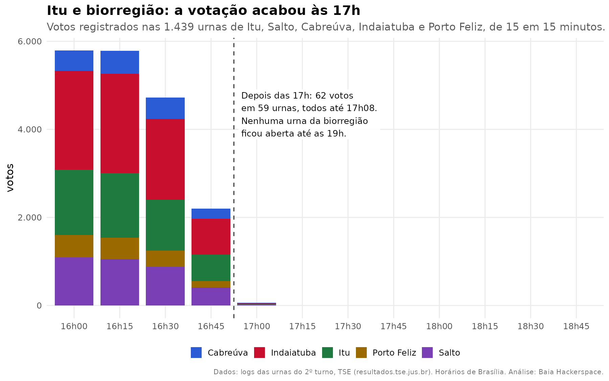
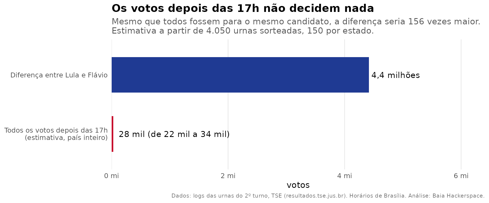
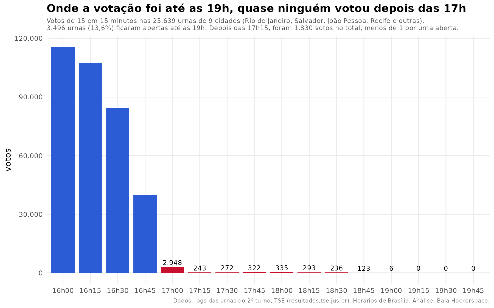

# O mito do impacto da prorrogação das Eleições 2026. Abrimos os logs das urnas e contamos voto por voto

2º turno, 25/10/2026.

Depois da vitória de Lula, um tipo de frase começou a circular: "a eleição foi decidida na prorrogação". O conflito causado pelo boicote ao transporte público em muitas cidades brasileiras levou a uma decisão judicial do STF preservando os direitos dos eleitores. Isso estendeu a votação até as 19h em alguns lugares, e a divulgação dos resultados ficou parada das 17h07 às 19h04. Para muita gente, esse intervalo bastou para criar desconfiança, inclusive com pouca energia, [Trump](https://noticias.uol.com.br/internacional/ultimas-noticias/2026/10/26/trump-diz-que-eleicao-presidencial-no-brasil-pareceu-fraudada.ghtm).

Aqui a gente prefere olhar os dados. E esses dados existem: o TSE publica o **log de cada urna**, um arquivo que registra cada evento da máquina com data e hora, inclusive cada vez que um voto é computado. O log não diz em quem a pessoa votou, porque o voto é secreto, mas diz **a que horas** ela votou.

Baixamos esses logs e contamos.

## Itu e biorregião: a votação acabou às 17h

Começamos olhando perto de casa. Abrimos **todas as 1.439 urnas** de Itu, Salto, Cabreúva, Indaiatuba e Porto Feliz, que somaram 404.343 votos.

- **62 votos** foram dados depois das 17h, em 59 urnas. Isso é **0,015%** dos votos da biorregião.
- Todos esses votos aconteceram **até as 17h08**. Só um passou das 17h05, em Salto.
- **Nenhuma urna da biorregião ficou aberta até as 19h.** A última foi encerrada às 17h19, em Porto Feliz.

Por cidade:

| cidade | urnas | votos | votos depois das 17h | último voto |
|---|---:|---:|---:|---:|
| Indaiatuba | 571 | 161.570 | 22 | 17h02 |
| Itu | 373 | 100.904 | 15 | 17h03 |
| Salto | 273 | 79.035 | 15 | 17h08 |
| Porto Feliz | 117 | 33.753 | 5 | 17h02 |
| Cabreúva | 105 | 29.081 | 5 | 17h01 |

Esses votos depois das 17h não têm nada de irregular. A regra de sempre é que quem já está na fila às 17h vota, e o mesário só encerra a urna depois do último eleitor. Aqui na biorregião, a fila acabou em poucos minutos.

## O Brasil: cerca de 28 mil votos depois das 17h

Para o país inteiro, sorteamos **150 urnas em cada estado**, 4.050 no total, e fizemos a mesma conta. Nos estados com outro fuso, os horários foram convertidos para o de Brasília.

- Estimamos **cerca de 28 mil votos depois das 17h** no Brasil inteiro, entre 22 mil e 34 mil, com 95% de confiança. Isso é **0,023%** dos 123,4 milhões de votos válidos.
- A diferença entre Lula e Flávio foi de **4,4 milhões de votos**, 156 vezes maior.
- Mesmo no cenário mais extremo, em que todos esses votos fossem para o mesmo candidato, a diferença final continuaria acima de 4,3 milhões.
- Em nenhum estado os votos depois das 17h passaram de **0,06%** do total. Os maiores percentuais foram em Rondônia, no Distrito Federal e em Mato Grosso, onde nenhuma urna sorteada ficou aberta até as 19h. Isso indica que a maior parte desses votos é a fila normal das 17h.

## Onde as urnas ficaram abertas até as 19h

A amostra mostrou que a prorrogação aconteceu de fato. Em 21 das 4.050 urnas sorteadas, a votação só foi encerrada perto das 19h. Elas ficavam em Salvador, João Pessoa, Recife, Cabo de Santo Agostinho, Caruaru, Floresta, Rio de Janeiro, Aracaju e Cristinápolis.

Para não depender de amostra, abrimos **todas as urnas** dessas 9 cidades.

São **25.639 urnas** e **7,8 milhões de votos**.

- **3.496 urnas**, 13,6% do total, ficaram abertas até as 19h, em 592 locais de votação. As outras 21.905 foram encerradas entre 17h00 e 17h15, como de costume, mesmo nessas cidades.
- Nessas 3.496 urnas, foram **2.001 votos depois das 17h05**, menos de 1 por urna. **Mais da metade delas (1.818) não recebeu nenhum voto depois das 17h.** Ficaram abertas, com mesários de prontidão, esperando eleitores que não apareceram. A prorrogação demorou a ser feita e quando aconteceu, perdeu sua eficácia.
- Somando as 9 cidades, foram **2.272 votos depois das 17h05** e **1.587 depois das 17h30**, em 7,8 milhões. É **0,03%** dos votos.
- O último voto do país, até onde vimos, foi às 19h01, numa urna do Rio de Janeiro.

| cidade | urnas | abertas até as 19h | votos no dia | votos depois das 17h05 | votos depois das 17h30 |
|---|---:|---:|---:|---:|---:|
| Rio de Janeiro (RJ) | 12.635 | 2.115 | 3.814.870 | 1.334 | 1.039 |
| Salvador (BA) | 5.124 | 744 | 1.647.069 | 683 | 372 |
| João Pessoa (PB) | 1.714 | 292 | 509.916 | 117 | 79 |
| Recife (PE) | 3.481 | 224 | 1.062.907 | 100 | 69 |
| Cabo de Santo Agostinho (PE) | 496 | 41 | 148.495 | 16 | 14 |
| Aracaju (SE) | 1.354 | 40 | 361.102 | 12 | 9 |
| Caruaru (PE) | 708 | 29 | 225.808 | 8 | 3 |
| Floresta (PE) | 75 | 10 | 20.384 | 2 | 2 |
| Cristinápolis (SE) | 52 | 1 | 11.716 | 0 | 0 |

O Rio de Janeiro, onde a prorrogação foi mais ampla, teve 1.334 votos depois das 17h05. Lá, isso é um voto a cada 2.860.

Esses números das 9 cidades já estão dentro da estimativa nacional de 28 mil. A maior parte daqueles 28 mil é a fila normal das 17h em todo o país. A parte que vem da prorrogação propriamente dita se conta em poucos milhares.

## O que os dados mostram, e o que não mostram

**Mostram que:**
- os votos depois das 17h existiram e foram poucos: um a cada 4 mil, no país;
- a maior parte deles foi de quem estava na fila às 17h, como em qualquer eleição;
- onde a urna ficou aberta até as 19h, quase ninguém apareceu para votar no horário extra: menos de 1 voto por urna, e mais da metade delas não recebeu ninguém;
- nenhuma combinação desses votos chega perto de mudar uma diferença de 4,4 milhões.

**Não mostram:**
- em quem esses eleitores votaram. O voto é secreto e o log não guarda isso. Mas, para mudar o resultado, cada um desses votos teria que valer por mais de 100.

A prorrogação garantiu o direito de votar a quem enfrentou o boicote ao transporte. É isso que ela foi: uma garantia para alguns milhares de eleitores, e não a razão da vitória.

## Como fizemos

- Os logs das urnas estão no site de resultados do TSE, urna por urna. Baixamos o arquivo `log.jez` de cada seção e contamos os eventos "O voto do eleitor foi computado" do dia 25/10.
- Seções agregadas votam na urna da seção principal e entram somadas a ela.
- "Urna aberta até as 19h" significa que o mesário só encerrou a votação a partir das 18h55.
- A estimativa nacional usa um sorteio de 150 urnas por estado, com semente fixa, então qualquer pessoa pode repetir o mesmo sorteio. A faixa de 95% considera a variação entre as urnas sorteadas.
- O script é aberto e funciona para qualquer cidade, [veja aqui](https://github.com/baiahacker/eleicoes-2026).
